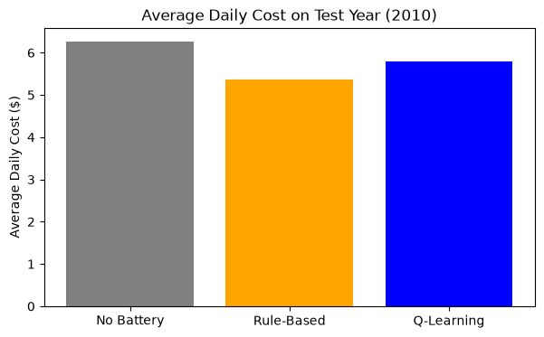
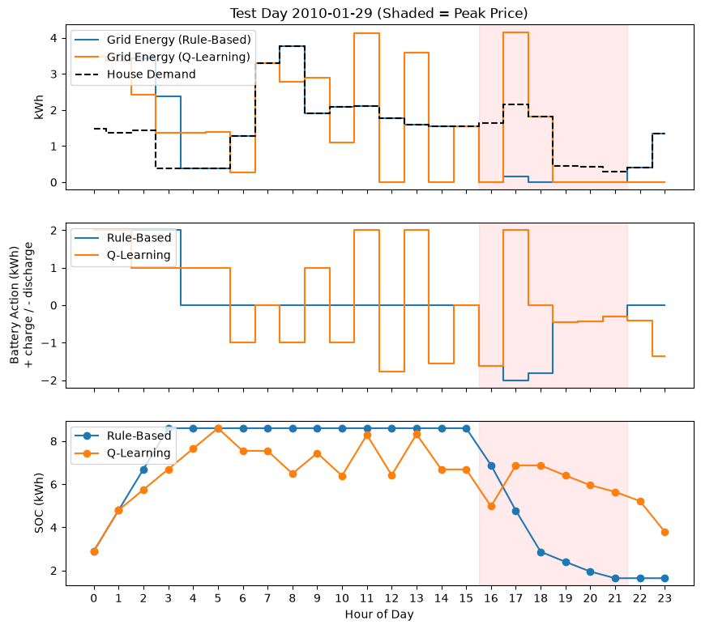

# Smart Home Battery Optimization with Reinforcement Learning

A tabular Q-learning agent that decides, hour by hour, when a home battery should charge or
discharge so the household pays less for electricity under a time-of-use tariff. The agent is
trained and evaluated on four years of real household demand from the UCI Individual Household
Electric Power Consumption dataset (2M+ minute-level readings).

**Stack:** Python, NumPy, pandas, Matplotlib

## Key results (unseen test year, 2010)

| Controller | Avg. daily cost | Savings vs. no battery | Infeasible commands / day |
|---|---:|---:|---:|
| No battery | $6.27 | — | 0 |
| Rule-based (charge overnight, discharge at peak) | $5.37 | 14.4% | 0.455 |
| **Q-learning** | **$5.80** | **7.5%** | **0.016** |

- Q-learning cut the daily bill by **7.5%** while issuing **28x fewer infeasible battery
  commands** than the rule-based controller (commands the battery cannot carry out because of its
  charge or rate limits).
- The hand-written rule saves more money in this simulator. The comparison is a trade-off, not a
  clean win, and it is discussed under [Limitations](#limitations).
- Results held across seasons: Q-learning saved 8.2% (winter), 8.1% (spring), 3.4% (summer), and
  9.0% (fall).



## How it works

1. **Data preparation.** Minute readings of household power are averaged into hourly demand.
   Hours with fewer than 45 recorded minutes are treated as missing, and only complete 24-hour
   days are kept (1,411 days in total).
2. **Chronological split.** 2006–2008 trains the agent (738 days), 2009 is used to compare
   hyperparameters (359 days), and 2010 is held out for the final evaluation (314 days). Splitting
   by year prevents the agent from seeing future data during training.
3. **Battery simulator.** A 10 kWh battery usable between 10% and 90% charge, limited to
   2 kWh per hour, with 95% charging and discharging efficiency. Each day starts at the minimum
   charge, and energy cannot be sold back to the grid.
4. **Tariff.** $0.15/kWh off-peak (10 p.m.–6 a.m.), $0.22/kWh normal (6 a.m.–4 p.m.), and
   $0.35/kWh peak (4 p.m.–10 p.m.).
5. **Reinforcement learning formulation.**
   - **State:** hour of day (24) × battery charge level (10 bins) × demand level (low, medium, or
     high, cut at the 33rd and 67th percentiles of training demand), giving 720 states.
   - **Actions:** discharge 2 kWh, discharge 1 kWh, idle, charge 1 kWh, or charge 2 kWh.
   - **Reward:** the negative cost of the electricity drawn from the grid that hour, minus a 0.5
     penalty when the requested action is infeasible.
6. **Training.** Tabular Q-learning for 50,000 simulated days with epsilon-greedy exploration
   (epsilon decays from 1.0 to 0.05 over the first 80% of episodes).
7. **Evaluation.** The agent is compared with a no-battery baseline and a rule-based controller
   on average daily cost, peak grid draw, and infeasible commands per day.

A typical winter test day shows how the two controllers use the battery differently:



## Experiments

**Hyperparameter study** (one setting changed at a time, scored on the 2009 validation year so the
test year stays unseen):

| Parameter | Finding |
|---|---|
| Learning rate α (0.01, 0.1, 0.5) | 0.1 was best. Both 0.01 and 0.5 cost more and issued far more infeasible commands. |
| Discount γ (0.5, 0.9, 1.0) | 1.0 was best. At 0.5 the agent learned to leave the battery idle, because charging costs money now and only pays off hours later. |
| Exploration decay (0.1, 0.4, 0.8) | Faster decay was slightly cheaper but produced 5x more infeasible commands. |
| Infeasibility penalty (0, 0.5, 2.0) | With no penalty, the agent issued 3.26 infeasible commands per day. A penalty of 2.0 cut that to 0.006 and was also slightly cheaper than the default of 0.5. |
| Training episodes (5.5K to 100K) | 50,000 was best. At 5,500 episodes the agent issued 1.44 infeasible commands per day, and 100,000 gave no further gain. |

**Generalization test:** an agent trained only on summer days and tested on winter days matched the
cost of the agent trained all year ($7.77 vs. $7.78 per day). However, it issued 0.30 infeasible
commands per day, compared with 0 for the all-year agent, so it had not learned the winter
charge levels well.

## Limitations

- **The rule-based controller is cheaper here.** The simulator clips infeasible commands to what
  the battery can do, so the rule loses nothing by issuing them. Infeasible commands matter when a
  controller drives real hardware that rejects them or treats them as faults. With realistic
  consequences for those commands, the comparison could change.
- **Higher peak grid draw.** Q-learning raised the average daily peak grid draw (3.57 kWh vs.
  2.58 kWh with no battery), because the reward only prices energy and does not penalize peaks.
- **Coarse state.** Ten charge bins and three demand levels lose information, and the agent
  cannot see upcoming demand. As the winter-day plot shows, it sometimes makes poor choices, such
  as charging during a peak-price hour.
- **Simulated battery and tariff.** The battery model ignores degradation, and the tariff is
  synthetic rather than taken from a real utility rate.

**Possible next steps:** add a peak-demand term to the reward, use the 2.0 penalty found in the
study, include a short demand forecast in the state, and replace the Q-table with a function
approximator (for example, a DQN) so the state does not need to be binned.

## Run it locally

Requirements: Python 3.10+.

```bash
pip install -r requirements.txt
jupyter notebook battery_rl.ipynb
```

Run all cells. The notebook downloads the dataset from the UCI Machine Learning Repository with
`ucimlrepo`. If the download fails, place `household_power_consumption.txt` from the
[UCI dataset page](https://archive.ics.uci.edu/dataset/235/individual+household+electric+power+consumption)
next to the notebook and it is read from there. A full run, including the hyperparameter study,
takes about 10 minutes.

## Repository contents

- **battery_rl.ipynb** — the full project: data cleaning, exploratory plots, battery simulator,
  baselines, Q-learning, evaluation, seasonal analysis, generalization test, and hyperparameter
  study. Cells marked *AI-Assisted* were written with help from an AI assistant.
- **assets/** — figures from the notebook used in this README.
- **requirements.txt** — Python packages needed to run the notebook.

Built for ELET 6303 (Applied Neural Networks) at the University of Houston.
